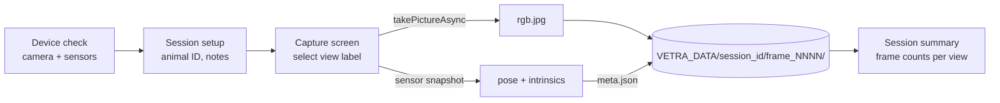

# VETRA Depth Recorder (Expo prototype)

**Cross-platform field-capture app that records multi-view RGB frames of cattle/buffaloes together with per-frame camera intrinsics and phone-sensor pose metadata, for the VETRA trait-measurement pipeline.**


> **Superseded.** This was an early attempt at a depth/pose capture tool for VETRA, scaffolded with the Emergent AI app builder. True depth was never available through Expo, so it was replaced by the native ARCore recorder in [vetra-depth-recorder-latest-v3](https://github.com/rupeshbharambe24/vetra-depth-recorder-latest-v3).

## Contents

- [Overview](#overview)
- [Highlights](#highlights)
- [How it works](#how-it-works)
- [Output format](#output-format)
- [Tech stack](#tech-stack)
- [Project structure](#project-structure)
- [Getting started](#getting-started)
- [Limitations](#limitations)
- [VETRA project map](#vetra-project-map)
- [License](#license)

## Overview

VETRA scores cattle and buffalo body traits from smartphone photos. Converting keypoint distances from pixels to centimetres needs scale information, so the team explored recording depth and camera pose alongside each photo.

This app is the first version of that capture tool. A field user creates a session for an animal, captures frames from labelled viewpoints (left/right side, front, rear, top), and the app writes each frame to on-device storage as a JPEG plus a JSON file with estimated camera intrinsics, device orientation and raw sensor readings.

## Highlights

- Four-screen Expo Router flow: device check → session setup → capture → session summary.
- Real camera capture via `expo-camera`, with view-label chips for the six capture angles.
- Accelerometer, gyroscope, magnetometer and device-motion streams sampled at 10 Hz and snapshotted into every frame.
- Per-frame metadata: intrinsics (`fx, fy, cx, cy`), quaternion, 3x3 rotation and 4x4 transform matrices, timestamps, view label.
- Session-scoped folder layout (`VETRA_DATA/session_<id>/frame_NNNN/`) designed to feed an offline reconstruction/measurement step.
- Falls back to "mock" frames (shown with a badge) when the camera is unavailable, e.g. in the web build.

## How it works



Capture logic lives in [`frontend/src/services/CaptureService.ts`](frontend/src/services/CaptureService.ts) (sensor subscriptions, pose/intrinsics estimation, file writes) and session state in [`frontend/src/context/SessionContext.tsx`](frontend/src/context/SessionContext.tsx).

## Output format

```text
<app documents>/VETRA_DATA/
└── session_<sessionId>/
    ├── frame_0001/
    │   ├── rgb.jpg
    │   └── meta.json
    └── frame_0002/ ...
```

<details>
<summary><code>meta.json</code> fields</summary>

| Field | Content |
|---|---|
| `frameId`, `sessionId`, `viewLabel` | identifiers; view is one of `left_side, right_side, front, rear, top, other` |
| `timestampMs`, `timestampIso` | capture time |
| `image` | `path`, `width`, `height`, `format` |
| `depth` | always `available: false` in this version (placeholder for real depth) |
| `intrinsics` | `fx, fy` estimated from an assumed ~70° horizontal FOV; `cx, cy` = image centre |
| `pose` | `quaternion`, `translation`, `rotationMatrix` (3x3), `transformMatrix4x4` (row-major) |
| `sensors` | latest accelerometer, gyroscope, magnetometer and device-motion readings |
| `device` | platform and coarse model string |

</details>

## Tech stack

| Layer | Technology |
|---|---|
| App | Expo SDK 54, Expo Router, React Native 0.79, TypeScript |
| UI | React Native Paper, `@expo/vector-icons` |
| Device APIs | `expo-camera`, `expo-sensors`, `expo-file-system` |
| Backend (unused template) | FastAPI + Motor (MongoDB) |

## Project structure

```text
VETRA---Depth-Recorder/
├── frontend/                     # Expo app (the actual prototype)
│   ├── app/                      # Expo Router screens
│   │   ├── _layout.tsx
│   │   ├── index.tsx             # device capability check
│   │   ├── session-setup.tsx     # animal ID + notes
│   │   ├── capture.tsx           # camera + view-label selection
│   │   └── session-summary.tsx   # per-view counts, data location
│   ├── src/
│   │   ├── context/SessionContext.tsx
│   │   ├── models/               # FrameCapture, Session types
│   │   ├── services/CaptureService.ts
│   │   └── theme/appTheme.ts
│   ├── assets/                   # fonts, app icons
│   ├── app.json, metro.config.js, package.json, yarn.lock
│   └── scripts/reset-project.js  # Expo template helper
├── backend/                      # FastAPI/MongoDB starter from the scaffold (not called by the app)
│   ├── server.py
│   ├── requirements.txt
│   └── .env.example
├── LICENSE
└── README.md
```

## Getting started

**Prerequisites:** Node.js 18+, Yarn 1.x (or npm), and the Expo Go app or an Android/iOS emulator.

```bash
git clone https://github.com/rupeshbharambe24/VETRA---Depth-Recorder.git
cd VETRA---Depth-Recorder/frontend
yarn install            # or: npm install
npx expo install --fix  # align Expo package versions if the install warns about mismatches
npx expo start          # press a (Android), i (iOS) or w (web)
```

Camera and motion sensors only work on a real device; the web build records mock frames.

<details>
<summary>Optional: run the template backend</summary>

The backend is the FastAPI + MongoDB starter generated by the scaffold (`/api/` hello-world and `/api/status` CRUD). The app does not call it.

```bash
cd backend
cp .env.example .env    # set MONGO_URL / DB_NAME
pip install -r requirements.txt
uvicorn server:app --reload --port 8001
```

</details>

## Limitations

- **No real depth.** Expo has no ARCore/ARKit depth access, so `depth.available` is always `false`.
- **Approximate pose.** The quaternion is built directly from device-motion Euler angles (not a proper Euler→quaternion conversion) and translation is always zero.
- **Estimated intrinsics.** Focal length assumes a ~70° field of view rather than reading calibrated values.
- **No export/upload.** Data stays in the app's document directory.
- App icons are still the scaffold's default artwork.

These gaps are why the project moved to a native Flutter + Kotlin ARCore recorder.

## VETRA project map

VETRA (SIH 2025, Grand Finale Top 5) is split across several repositories. ML work evolved v1.1 → v2.0 → v2.2 → v3.0; the apps below consume or capture data for those models.

| Repository | What it is | Stack | Status |
|---|---|---|---|
| [VETRA-v1.1](https://github.com/rupeshbharambe24/VETRA-v1.1) | First ML experiment: 6-keypoint YOLO pose on cow images + regression models mapping keypoint distances to body measurements (cm) | Python, YOLOv8-pose, scikit-learn | Archived (ML) |
| [VETRA-v2.0](https://github.com/rupeshbharambe24/VETRA-v2.0) | Separate side- and back-view YOLOv8-pose keypoint models, focal-length scaling, measurement-extraction notebooks | Python, Ultralytics | Archived (ML) |
| [VETRA-v2.2-with-app](https://github.com/rupeshbharambe24/VETRA-v2.2-with-app) | v2 models wrapped in a first FastAPI backend + React UI (`/api/v1/process-image`) | Python, FastAPI, React | Archived (ML + app) |
| [VETRA-v3.0](https://github.com/rupeshbharambe24/VETRA-v3.0) | Final training: side (16 kp), back (10 kp) and udder-bottom (8 kp) YOLOv8n-pose models, ArUco scaling, dataset tooling | Python, Ultralytics, PyTorch | Final models |
| [VETRA---App](https://github.com/rupeshbharambe24/VETRA---App) | Final system: FastAPI backend serving the v3.0 pose models + udder U-Net/ResNet18, NDDB-style trait scoring, React web UI | FastAPI, PyTorch, React + Vite | Final (SIH 2025 finale) |
| [vetra-main-app-latest-v3](https://github.com/rupeshbharambe24/vetra-main-app-latest-v3) | Flutter field app: capture protocol, offline SQLite records, PDF reports (not yet wired to the analysis API) | Flutter, Riverpod, SQLite | Prototype |
| [vetra-depth-recorder-latest-v3](https://github.com/rupeshbharambe24/vetra-depth-recorder-latest-v3) | RGB + ARCore depth capture with intrinsics, pose and ZIP export | Flutter, Kotlin, ARCore | Prototype |
| **[VETRA---Depth-Recorder](https://github.com/rupeshbharambe24/VETRA---Depth-Recorder)** (this repo) | Earlier capture app: RGB frames + phone-sensor pose metadata (no real depth) | Expo / React Native, TypeScript | Superseded |
| [vetra-pashu-scan](https://github.com/rupeshbharambe24/vetra-pashu-scan) | Early Lovable-generated PWA UI; Supabase edge functions return mock measurements | Vite, React, Supabase | Superseded (UI prototype) |
| [pashudhan-ui](https://github.com/rupeshbharambe24/pashudhan-ui) | Fork of a teammate's Lovable UI prototype (landing page + mock prediction page) | Vite, React | Fork |

## License

[MIT](LICENSE) © 2025 Rupesh Bharambe
